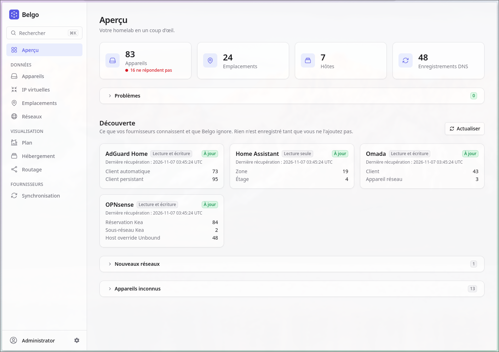

# Belgo



**Note**: Proper auth is not finished yet. Take precautions into hiding behind a 
reverse proxy authentication and. **Don't. Expose. This. To. Internet. Please.**

Homelab manager: the single source of truth for the machines of the network, where
they physically are, what runs on what, and the DNS / DHCP / client names AdGuard
Home, OPNsense and Omada must agree on. The inventory is a set of YAML files you
can edit by hand and version with git; there is no database.

## Features

* Inventory of devices, interfaces, networks (with named address ranges), locations
  and virtual IPs, with consistency checks (duplicate addresses, dangling links…).
* Discovery from OPNsense, AdGuard Home, Omada and Home Assistant: unknown devices,
  networks and locations to claim, divergences to reconcile.
* Non-destructive sync: DHCP reservations, DNS names and client names are pushed to
  the providers, never deleted, except the Kea reservations of deleted devices and
  interfaces.
* Physical, hosting and routing views; device reachability, open ports and
  wake-on-LAN.
* Home plan in 2D and 3D with devices placed in their rooms.
* English and French interface.

Details: [docs/guide.md](docs/guide.md).

## Deployment

```sh
docker pull nboisvert/belgo:latest
```

Run it with a writable volume on `/data` (the inventory files) and at least
`SECRET_KEY_BASE`, `LIVE_VIEW_SALT` and `APP_HOST`, behind Authelia's forward auth
(trusted `Remote-*` headers); Belgo is meant for the internal network only.
Providers are optional (`providers.yaml`, secrets in environment variables). See
[Docker](docs/guide.md#docker) for a `docker run` / Compose example, the Helm
chart in `charts/belgo` for [Kubernetes](docs/guide.md#kubernetes) and the
[configuration](docs/guide.md#configuration).

Releases follow `VERSION`: a push to `main` with a new version runs the tests,
pushes the image to Docker Hub and creates the GitHub release
([details](docs/guide.md#releasing)).

## Development

```sh
nix develop
just seed     # copies examples/inventory to ./data
just setup
just dev      # http://localhost:4000
just check    # format, warnings, credo, tests
```

`.envrc` provides development defaults (static user, `./data`).
